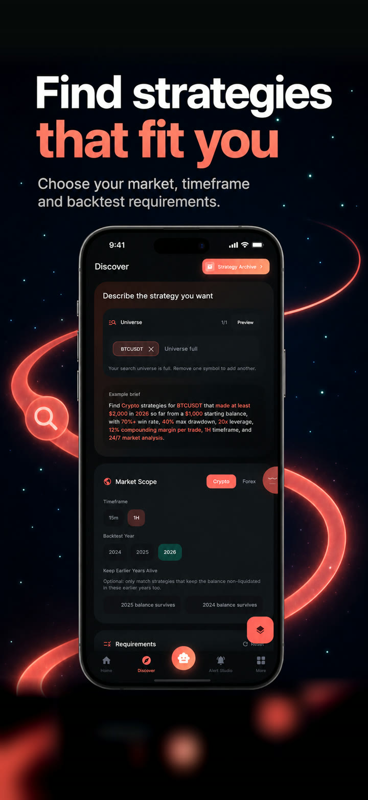

# ZealyOn

**A strategy research and trading platform for crypto and forex**

ZealyOn helps people discover rule-based strategies, inspect how those strategies have behaved, and decide how they want to follow their signals. The product brings strategy research, account context, alerts, and supported broker connections into one cross-platform experience.

It is designed to give people more context than a standalone trade call. A strategy can be reviewed without connecting an account. Users who want notifications can set up alerts; users who want supported external execution can connect their own broker or exchange account.

## Product walkthrough

### Discover

Discover lets a user describe a strategy search with criteria such as market, timeframe, symbols, historical period, and limits for win rate, drawdown, or ending balance. The search returns candidates that can be previewed and reviewed. A match is a research result, not an enabled strategy or a trade in a broker account.

### Strategy Hub

Strategy Hub is the main space for browsing and comparing strategies. Users can filter and sort the catalogue, open a strategy, review its available history and analysis, compare alternatives, and inspect recorded positions and trades.

Performance views distinguish between historical backtests, the shared forward-tracked strategy record, Demo activity, and the user's own connected account history. These are different evidence sources and should not be treated as interchangeable. Historical performance does not predict or guarantee future outcomes.

### Alerts and connected accounts

Alert plans let people choose strategies to follow and configure delivery through supported channels such as Telegram or Discord. Strategy alerts and supported External Live routes use signals from the same engine. A connected account remains the user's own account, and ZealyOn does not hold their trading funds.

The product includes separate setup and review steps for alerts and connected execution. Purchasing access, connecting an account, saving a strategy preference, receiving an alert, and seeing an executed order are distinct events.

## Interface preview

  

Discover interface preview. The values shown are example search criteria, not a performance claim.

## Engineering

The mobile and desktop clients are built with Flutter and Dart. Rust services handle strategy search, historical evaluation, replay, and live monitoring. Supabase and PostgreSQL support account and application workflows, while market-data and provider integrations connect research results to alerts and supported account routes.

A key design boundary separates the shared strategy record from each user's personal execution and account activity. That lets the product show one monitored strategy record while keeping account-specific positions and fills in the user's own environment.

## Technology

Flutter, Dart, Rust, Supabase, PostgreSQL, market-data integrations, and broker or exchange connections.

## This repository

This is a public project summary and visual preview. It does not include the private application source, proprietary strategy rules, credentials, customer information, or operational configuration.

[Explore AceNetics](https://acenetics.dev)
